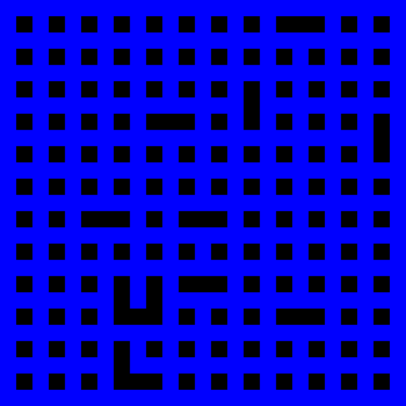
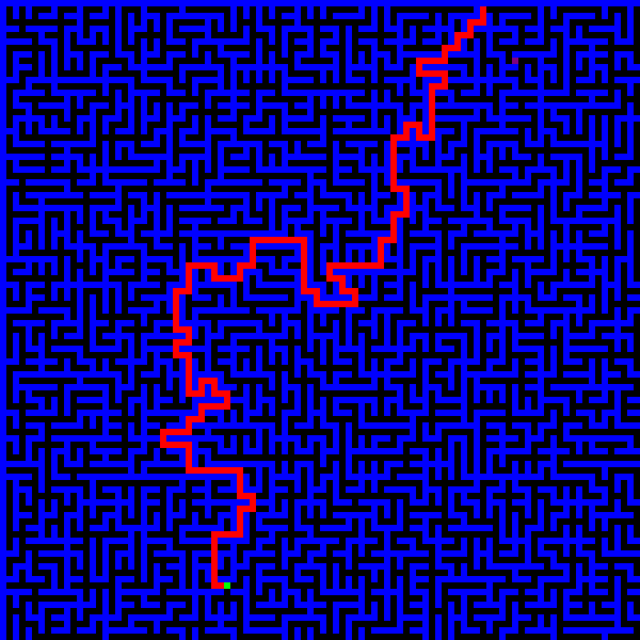
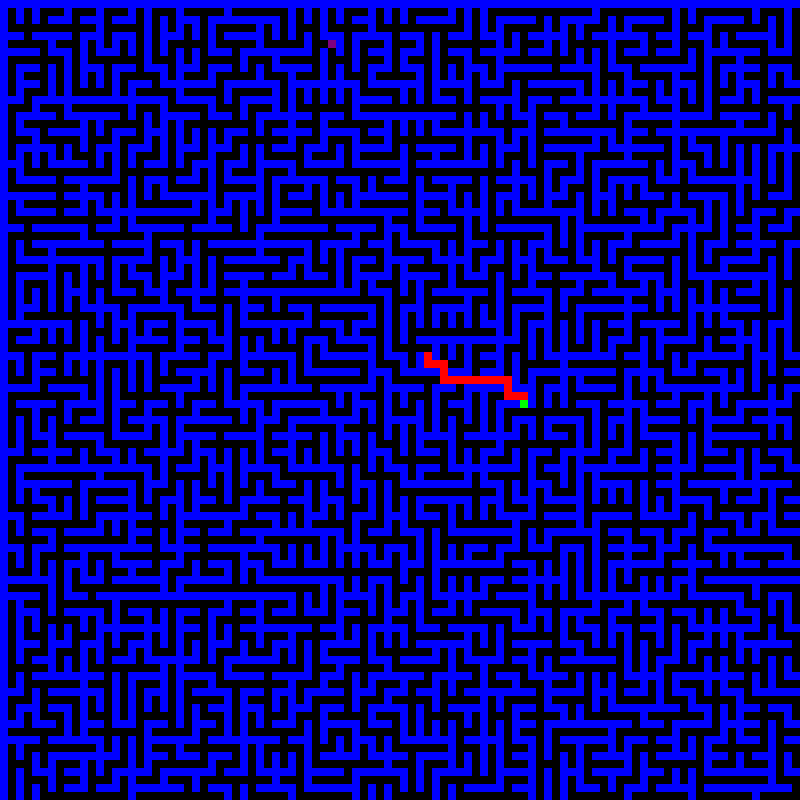
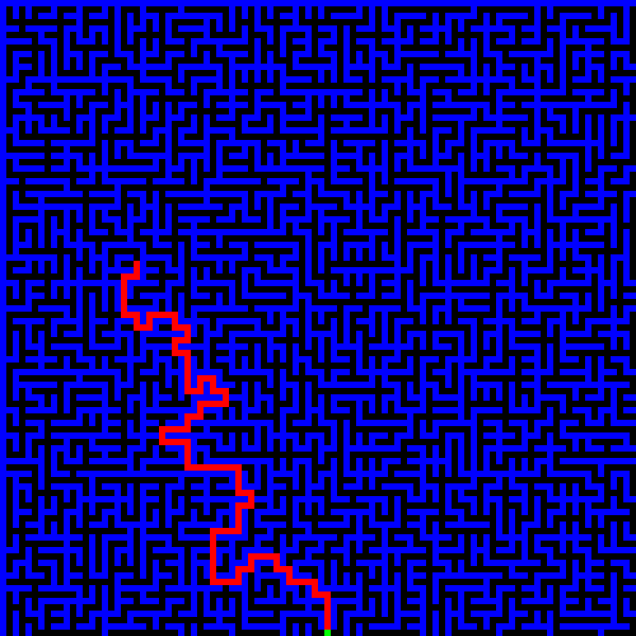
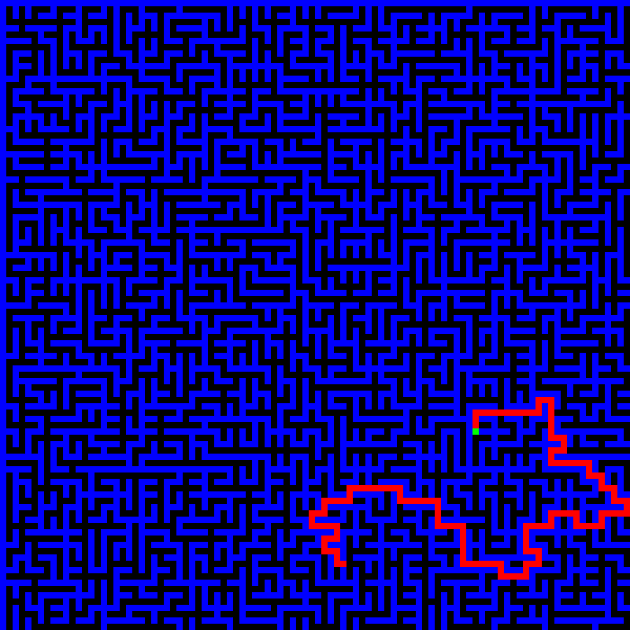

# Maze Generator & Pathfinder

A Python project for generating random mazes and visualizing shortest-path algorithms. Built as a learning project to explore graph algorithms and their visualization.

## Demo

### Maze Generation


A Kruskal-inspired algorithm generates a random maze. This demo uses a 25 × 25 grid to keep the animation fast.

### Pathfinding


Dijkstra's algorithm finds the shortest path between two randomly selected points in the maze. Since the grid is unweighted, Breadth-First Search (BFS) would also work.

### Pathfinding Speed Modes

**Step-by-step**



Draws the path one cell at a time.

**Instant**



Draws the complete path immediately, with a short pause between runs.

**Turbo**



Runs continuously without deliberate pauses.

## Technologies

- Python
- Pygame — visualization
- NumPy — grid representation

## Run

Install the dependencies:

```bash
pip install pygame numpy
```

Run the main script:

```bash
python main.py
```

Choose `g` to generate a maze, `l` to load one, `t` for test mode, or `p` for pathfinding.